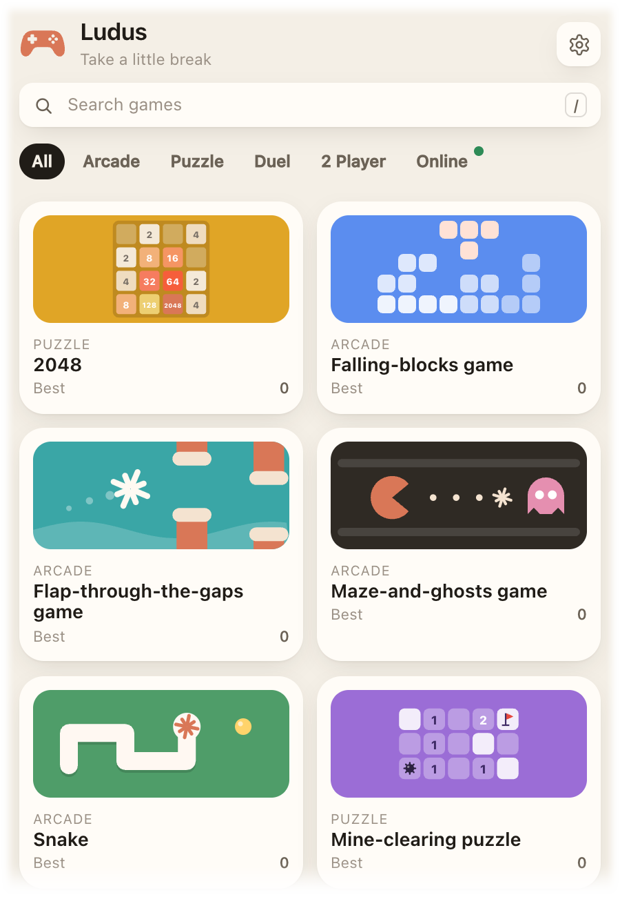
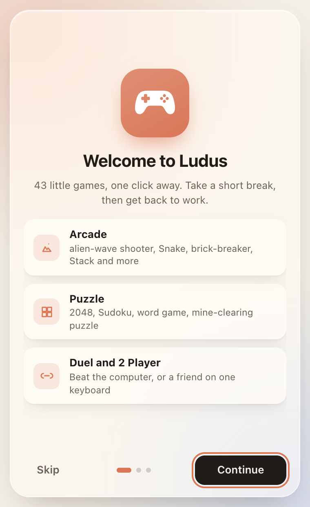
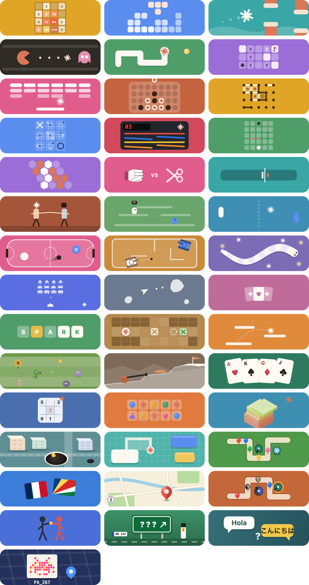
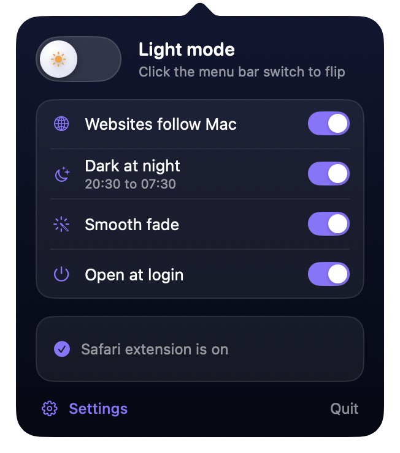
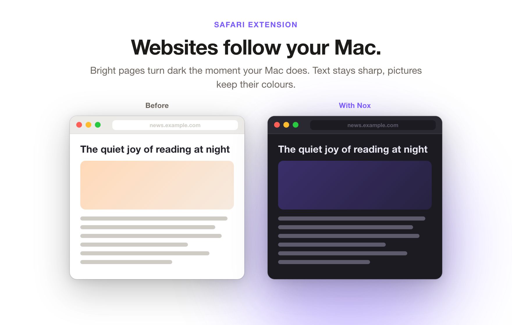
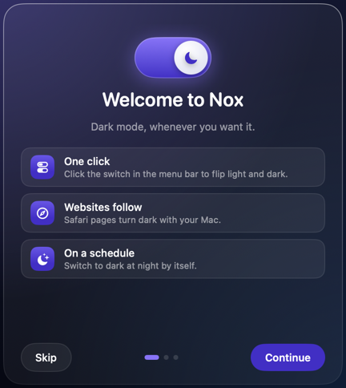
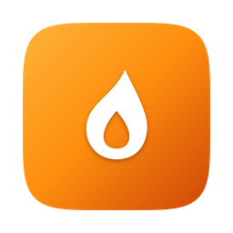
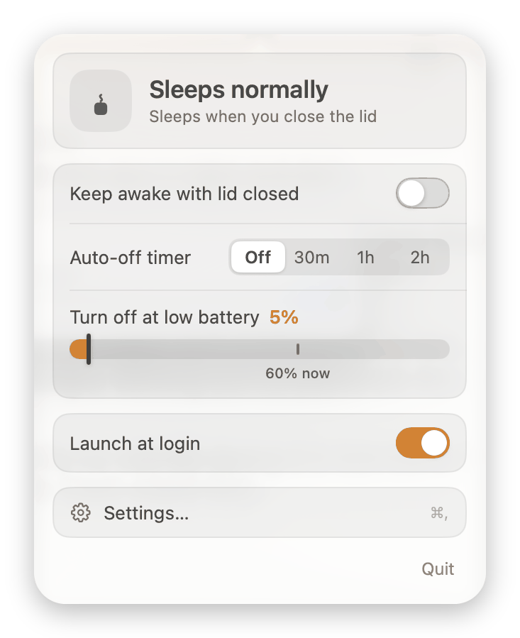
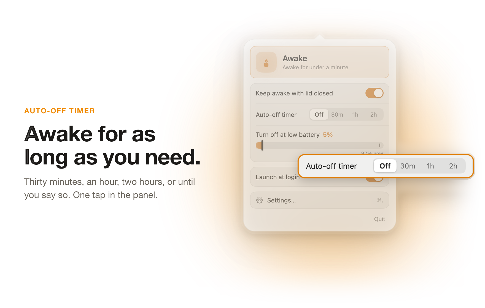
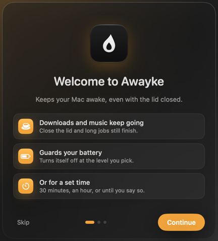

# Mac Apps

Four small, free apps by Solomon. Quiet, fast and made to stay out of your way. Open [index.html](index.html) for the full pages, or read on.

## Ludus

Little games for little breaks, right from your menu bar or tray. 43 quick mini games that work offline: arcade, puzzles, duels against the computer and two-player games.

 

Version 1.12.30, 43 games.

Download: [Mac (.zip)](https://github.com/Solomon-69/Ludus/releases/latest/download/Ludus-mac.zip) | [Windows](https://github.com/Solomon-69/Ludus/releases/latest/download/Ludus-windows.zip)

## Memo

Everything you copy, one shortcut away. Memo keeps a searchable history of text, links, pictures, files and colours, and pastes them back.

  

Version 1.1.1.

Download: [Mac](https://github.com/Solomon-69/Memo/releases/latest/download/Memo-mac.zip) | [Windows](https://github.com/Solomon-69/Memo/releases/latest/download/Memo-windows.zip)

## Nox

One switch for light and dark. Flip your Mac between light and dark, set a schedule, and make web pages follow.

  

Version 1.4.1.

Download: [Mac (.dmg)](https://github.com/Solomon-69/Nox/releases/latest/download/Nox.dmg) | [Mac (.zip)](https://github.com/Solomon-69/Nox/releases/latest/download/Nox-mac.zip) | [Windows](https://github.com/Solomon-69/Nox/releases/latest/download/Nox-windows.zip)

## Awayke

Keep your MacBook awake with the lid closed. Set a timer or a low-battery cutoff and forget about it.

  

Version 1.5.0.

Download: [Mac (.dmg)](https://github.com/Solomon-69/Awayke/releases/latest/download/Awayke.dmg) | [Mac (.zip)](https://github.com/Solomon-69/Awayke/releases/latest/download/Awayke-1.5.0.zip)

## Installing

**Mac:** open the .dmg (Ludus and Memo come as a .zip: unzip it) and drag the app to Applications. The first time, right-click the app and choose **Open**, then **Open** again. If you see no Open button, go to System Settings, Privacy & Security, and click **Open Anyway**.

**Windows:** unzip the download and run the app. If Windows SmartScreen warns you, click **More info**, then **Run anyway**.

Each app has its own Releases page (for example [Ludus](https://github.com/Solomon-69/Ludus/releases)); the download links above always give the latest build.

## Unsigned apps: how to open them, and how to check your download

These apps are not signed yet. Signing needs Apple's paid developer account (and a Windows code-signing certificate), which the project does not have yet. The apps are safe to use as far as the author knows, but your computer cannot prove who made them, so it warns you the first time.

- **Mac:** right-click the app, choose **Open**, then **Open** again. If there is no Open button, go to System Settings > Privacy & Security and click **Open Anyway**.
- **Windows:** if SmartScreen says "Windows protected your PC", click **More info**, then **Run anyway**.

To check that a download has not been changed, compare its SHA-256 fingerprint with the one in [CHECKSUMS.md](CHECKSUMS.md) (Mac: `shasum -a 256 <file>` in Terminal; Windows: `certutil -hashfile <file> SHA256`).

## Credits and trademarks

Awayke is based on Sleepless by Adam Boudjemaa (MIT). Ludus uses Leaflet, Pannellum, Panoramax photos and Esri map tiles; see THIRD_PARTY.md in the [Ludus repository](https://github.com/Solomon-69/Ludus) (page: https://solomon-69.github.io/Ludus/). Not affiliated with or endorsed by Apple, Microsoft or the makers of any game or app these resemble; all trademarks belong to their owners.

This page repository only shows the apps. Ludus is all rights reserved; Memo, Nox and Awayke are MIT licensed in their own repositories.
